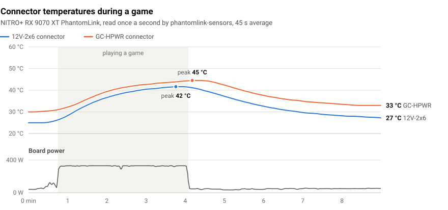

# phantomlink-sensors

[](https://github.com/candygoogy/phantomlink-sensors/releases/latest)
[](LICENSE)


Shows the power connector temperatures of the Sapphire NITRO+ RX 9070 XT PhantomLink in
[HWiNFO](https://www.hwinfo.com/).

The card measures the temperature at its 12V-2x6 and GC-HPWR connectors, but only Sapphire TriXX
displays it, on its Power Protection page. This tool reads the same sensors in the background and adds
them to HWiNFO, where you can graph them, log them, set alerts, or put them in the tray or your RTSS
in-game overlay.

<picture>
  <source media="(prefers-color-scheme: dark)" srcset="docs/session-dark.svg">
  
</picture>

It needs only the AMD Adrenalin driver, not TriXX. It never writes to the card, runs without admin rights
or a window, and uses about 10 MB of memory.

Unofficial. Not affiliated with or endorsed by Sapphire or HWiNFO.

## Quick start

1. Download [phantomlink-sensors.exe](https://github.com/candygoogy/phantomlink-sensors/releases/latest/download/phantomlink-sensors.exe).
2. Open a terminal in the download folder and run:
   ```
   .\phantomlink-sensors.exe --install
   ```
3. Restart HWiNFO.

It now runs in the background and starts again every time you log in.

## In HWiNFO

A sensor called **Sapphire Power Protection** appears near the end of HWiNFO's sensor list:

| Entry | Example | Meaning |
|---|---|---|
| 12V-2x6 Connector | 41 °C | Temperature at the 16-pin power connector |
| GC-HPWR Connector | 44 °C | Temperature at the PhantomLink motherboard connector. Reads warm even when unused, since it sits near the VRM |
| Temperature Danger | No | Yes when the card flags a connector as too hot (TriXX: Temperature DANGER) |
| Current Danger | No | Yes when the card flags too much current (TriXX: Current DANGER) |

The two Danger entries use the same rule as TriXX. The card's own protection works with or without any
software; this tool only reports.

HWiNFO puts custom sensors after its own while its Fixed Order setting is on (the default). You can turn
Fixed Order off and drag the sensor under your GPU, but HWiNFO then also drops its collapsible groups,
such as GPU Memory Temperatures.

## Supported cards

The tool runs on the cards TriXX 11.2 enables Power Protection for. All are Navi 48 (PCI `1002:7550`)
with Sapphire's subsystem vendor `1DA2`:

| Subsystem | Revision | Card |
|---|---|---|
| `E501` | C0 | NITRO+ RX 9070 XT PhantomLink (tested) |
| `501E` | C0 | listed by TriXX next to E501 |
| `4892` | C0, C3 | listed by TriXX, model unknown (C0 is an RX 9070 XT, C3 an RX 9070) |

`phantomlink-sensors --list` shows your card's IDs. Other Sapphire RX 9070 cards, such as the regular
NITRO+ (`E489`), may have the same sensor chip. You can try with `--force`; please
[open an issue](https://github.com/candygoogy/phantomlink-sensors/issues) with the output of `--list`
and `--once --force` either way.

## FAQ

**Does it need TriXX?**
No. It talks to the card through the AMD driver. TriXX can run at the same time without conflicts.

**Windows or my antivirus warns about it.**
The exe is not code-signed, so SmartScreen may show "Windows protected your PC" (More info, then Run
anyway), and some antivirus products react to unsigned programs that read GPU hardware or create
scheduled tasks. Releases are built from this source by GitHub Actions and come with a SHA-256 checksum.
You can also build it yourself, or add an exclusion for `%LOCALAPPDATA%\Programs\phantomlink-sensors`.

**Can it damage my card?**
It reads three registers of the sensor chip, the same reads TriXX makes every second, and takes the
shared I2C lock that TriXX and HWiNFO use. It never writes to the card.

**The values in HWiNFO stopped changing.**
The tool isn't running, and HWiNFO keeps showing the last values it received. Run
`phantomlink-sensors --once` to check that the card can be read, then start the `phantomlink-sensors`
task in Task Scheduler or run `--install` again.

**How do I remove it?**
`phantomlink-sensors --uninstall` removes the logon task, the installed copy and the HWiNFO sensor.

<details>
<summary><b>Install details</b></summary>

`--install` copies the exe to `%LOCALAPPDATA%\Programs\phantomlink-sensors`, registers a Task Scheduler
task that starts it 15 seconds after you log in, and starts it right away. The task runs with your normal
user rights, so there is no UAC prompt. It does not appear under Task Manager's Startup apps; you can see,
disable or delete it in Task Scheduler.

Before installing, `--once` shows whether the tool can read your card:

```
> phantomlink-sensors --once
adapter 0
12V-2x6 connector: 25 °C
GC-HPWR connector: 30 °C
temperature:       GOOD
current:           GOOD
status code:       0x00
```

To check the download, compare `Get-FileHash .\phantomlink-sensors.exe` in PowerShell with the
`phantomlink-sensors.exe.sha256` file on the release page.

</details>

<details>
<summary><b>All options</b></summary>

| Command | What it does |
|---|---|
| `phantomlink-sensors` | Run in the background and update HWiNFO every 2 seconds |
| `--install` | Copy to `%LOCALAPPDATA%\Programs`, start at every logon, and start now |
| `--uninstall` | Stop it and remove the logon task, the installed copy and the HWiNFO sensor |
| `--stop` | Stop the background instance |
| `--once` | Print the current readings and exit |
| `--list` | List AMD adapters as the driver sees them |
| `--remove` | Delete the HWiNFO sensor entries |
| `--version` | Print the version |

| Option | What it does |
|---|---|
| `--interval <ms>` | Polling interval in milliseconds (default 2000) |
| `--adapter <n>` | Use this adapter index instead of detecting the card |
| `--force` | Run on a Sapphire RX 9070 / 9070 XT that is not on the supported list |

</details>

<details>
<summary><b>How it works</b></summary>

A small controller on the card's I2C bus (line 1, address 0x50) measures the connectors. The tool reads
three of its registers through AMD's driver API (`ADL2_Display_WriteAndReadI2C`), the same reads TriXX
makes:

| Register | Value |
|---|---|
| `0x51` | 12V-2x6 connector temperature, °C |
| `0x60` | GC-HPWR connector temperature, °C |
| `0x64` | status: `0x01` or `0x10` connector too hot, `0x11` too much current, anything else OK |

It writes the values to HWiNFO's
[custom sensor](https://www.hwinfo.com/forum/threads/custom-user-sensors-in-hwinfo.5817/) registry keys
under `HKCU\Software\HWiNFO64\Sensors\Custom`, and holds the `Global\Access_ATI_I2C` lock around each
read so it doesn't collide with TriXX, HWiNFO or other tools on the same bus. On cards that are not on
the supported list it refuses to start without `--force`, because address 0x50 can be a different chip
on other boards.

I found the registers by logging TriXX's driver calls and comparing the values with its Power Protection
page. The notes, measurements and scripts are in [`research/`](research/). The controller also has five
channels that rise and fall with the 12V-2x6 load, probably per-pin current, but their scale is still
unknown. Measurements from other cards would help.

</details>

<details>
<summary><b>Building from source</b></summary>

```
cargo build --release
```

Windows only, Rust stable, target `x86_64-pc-windows-msvc`. Tagged releases are built by
[`release.yml`](.github/workflows/release.yml).

</details>

## License

[MIT](LICENSE)
